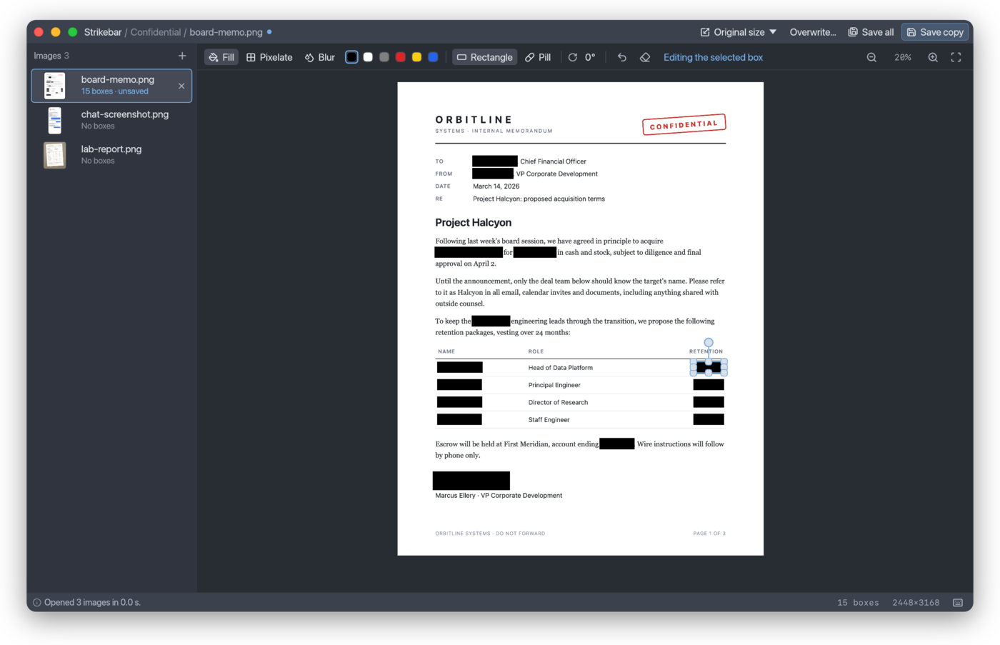
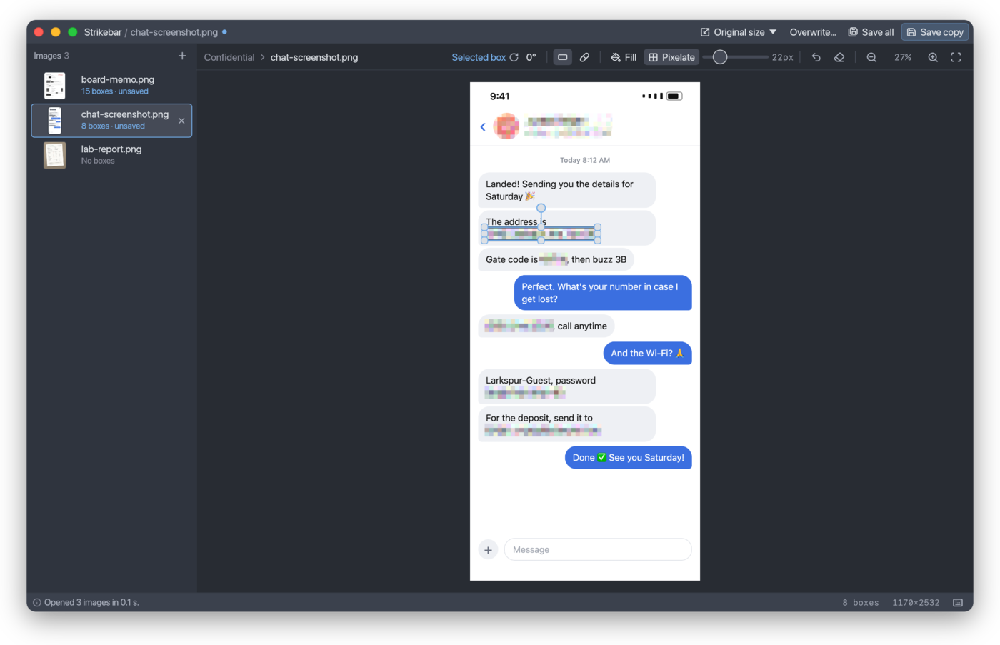
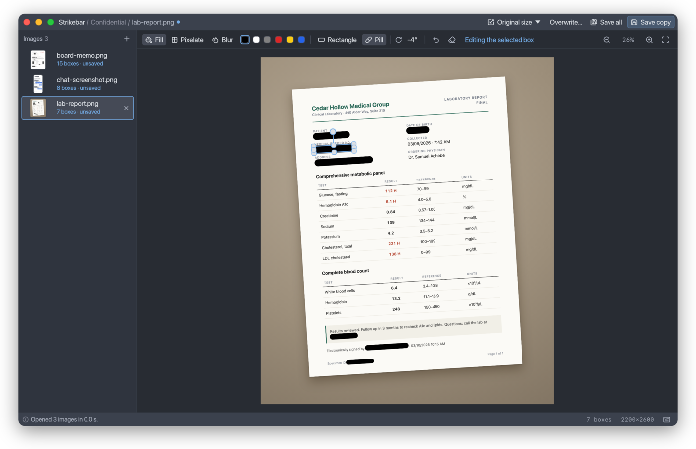

# Strikebar

Small native app for redacting parts of images. Rust + egui (eframe). Runs on macOS, Windows and Linux.



## Build requirements

HEIC/HEIF support uses [libheif](https://github.com/strukturag/libheif) (via `libheif-rs`), found with `pkg-config`:

```bash
brew install libheif pkgconf        # macOS
sudo apt install libheif-dev pkg-config   # Debian/Ubuntu
```

## Run

```bash
cargo run --release -- path/to/image.png other.jpg   # paths are optional
```

### macOS app bundle

```bash
brew install cmake pkgconf      # once, to build the minimal libheif
./scripts/bundle-macos.sh       # → target/Strikebar.app
```

The bundle is self-contained (runs without Homebrew):

- `scripts/build-libheif.sh` builds a minimal libheif from the sources vendored in `libheif-sys`, with only the libde265 HEVC decoder — no x265 (GPL) or aom, which Homebrew's libheif pulls in.
- `scripts/bundle-macos.sh` builds the app against it (in `target/bundle`, so dev builds keep using Homebrew's libheif), copies `libheif` and `libde265` into `Contents/Frameworks`, relinks them via `@rpath`, adds their LGPL-3.0 licenses under `Contents/Resources/licenses`, re-signs ad hoc, and fails if anything still points outside the app.
- libde265 is built from source too, so the app runs on macOS 11 and newer. `LSMinimumSystemVersion` is set to the newest macOS any bundled binary requires.
- The icon is `assets/icon.svg`. After editing it, run `./scripts/make-icon.sh` (needs `brew install resvg`) to regenerate `assets/Strikebar.icns` and `assets/icon-256.png`, which are kept in the repo so building doesn't need resvg.
- It's signed ad hoc, not notarized: on another Mac, open it with right-click → Open the first time.

### Releases and updates

```bash
./scripts/release.sh 0.2.0            # or: release.sh 0.2.0 notes.md
```

- The script bumps the version and runs the tests. It then builds the bundle and zips it as `Strikebar-<version>-macos-<arch>.zip`, and signs the zip with [minisign](https://jedisct1.github.io/minisign/). Next it commits `Release <version>` and tags `v<version>`. Last, after you confirm, it pushes and creates the GitHub release with the zip and its `.minisig`.
- In-app updates read the latest release of `binho/strikebar` from GitHub (Settings → General → Updates). *Install and relaunch* downloads the zip for the Mac's architecture and checks it before installing:
  - the signature must match the public key built into the app (`assets/update-key.pub`);
  - the signature's trusted comment must be that exact file name, so an older signed build can't be passed off as a newer one;
  - the bundle id must match, and `codesign --verify` must pass.
  
  The update then replaces the app bundle (staged next to it, then two renames, undone on failure) and reopens the same images. Unsaved boxes are lost, and the app warns about them first. Other platforms open the release page instead.
- The signing key lives outside the repo, at `~/.minisign/strikebar.key` (or `STRIKEBAR_SIGNING_KEY`). **Back it up**: without it, released apps can't verify future updates. Give it a password with `minisign -C -s ~/.minisign/strikebar.key`; the script asks for it when signing.
- To test updates without publishing, build with `STRIKEBAR_UPDATE_FEED=file:///path/feed.json` (any URL curl reads, in GitHub's release JSON format). It's read at build time, so release builds always use the real feed.

## Use





- **Open**: ⌘O / Open…, drag files onto the window, or pass paths on the command line.
- **Draw**: drag on empty space to add a box. The new box is selected.
- **Edit a box**: click it to select (outline + handles). Drag inside to move, drag a handle to resize, drag the ○ above it to rotate (Shift snaps to 15°) or type an angle in the toolbar. Pick Fill/Pixelate/Blur, a color or the block size to restyle it. Esc deselects.
- **Delete**: acts on what you clicked last. On the canvas it removes the selected box (right-click also removes a box); in the sidebar it removes the selected image from the list (the file on disk is untouched). ⌘Z undoes the last box.
- **Style**: `F` fill with a solid color (black, white, gray, red, yellow or blue; all opaque, safe for anything) `P` pixelate (large blocks plus random noise; blocks follow the box's rotation) or `B` blur (the same noisy blocks, smoothed into each other so it looks like a blur). Block size, which is also the blur strength, scales with the image (default 1/80 of its long side: ~100 px on a 48 MP photo, 20 px on a 1600 px screenshot), never below 1/200 of it.
- **Shape**: rectangle or pill (fully rounded ends), from the two buttons next to Fill/Pixelate/Blur. Like the style, it applies to new boxes and to the selected one. Rotation works with both; pill corners are left uncovered, so make the box big enough for what it hides.
- **Navigate**: two-finger scroll, middle-drag or Space+drag to pan; pinch, ⌘/Ctrl+scroll or ⌘+ / ⌘− to zoom; `0` or ⌘0 fit, `1` 100%; ↑/↓ switch images.
- **Formats**: PNG, JPEG, WebP, BMP, TIFF, GIF and HEIC/HEIF (read only). HEIC and GIF can't be written back, so their copies are saved as `name-redacted.jpg` and *Overwrite* is disabled for them.
- **Save**: *Save copy* (⌘S) writes `name-redacted.ext` next to the original (or as set in Settings); *Save all* does it for every image with boxes; *Overwrite original…* replaces the file after confirming.
- **Settings**: Strikebar → Settings… (⌘,) on macOS; the gear at the right of the title bar (Ctrl+,) on Windows and Linux. Kept between runs, along with the window's size and position.
  - *General*: appearance (Auto follows the system's light or dark mode and switches with it, or always Light or Dark); whether new boxes start with the last style, color and shape (on) or a black rectangle; the default Pixelate/Blur strength (Light, Medium or Strong: 1/120, 1/80 or 1/50 of the image's long side); and updates from the latest GitHub release: an automatic check (off unless turned on; once a day) or *Check now*, then *Install and relaunch* (see [Releases and updates](#releases-and-updates)). It runs `curl`, so no network code is built in.
  - *Saving*: copies go next to the original or into a folder you pick; the name gets a suffix or prefix (`-redacted` by default; taken names are numbered, so a copy never replaces anything); JPEG quality (50–100, default 92, also used for HEIC and GIF copies); the save size at launch; and what happens after saving (stay, show the file in Finder/Explorer, or go to the next image).
- **Size**: the picker next to the save buttons scales saved images down to a long side of 3840, 2560, 1920, 1280 or 800 px (default: original size). It applies to every save, overwrite included, and never enlarges smaller images; hover it to see the resulting size. Scaling happens after redacting, so redacted areas stay redacted.

## Notes on safety

- HEIC rotation (as stored by iPhones) is applied by libheif when decoding.
- Box edges are antialiased: only pixels the box partly covers are blended; pixels fully inside are always fully replaced. Straight boxes snap to whole pixels, so their edges stay crisp.
- Images decode on background threads (up to 4), and only the image on screen keeps a full-size GPU texture; edits re-render just the changed area.
- Saved files contain only pixels: EXIF, GPS and embedded thumbnails are dropped. EXIF orientation is applied on load so photos stay upright.
- The preview is rendered with the same code as the export, so what you see is what is saved.
- There is no real (Gaussian) blur: blurred text can often be recovered. *Blur* only looks like one: it's pixelate with the blocks smoothed into each other, so the saved pixels hold nothing but the noisy block averages. Pixelate and Blur add per-block random noise so they can't be reversed by guessing and comparing.

## Layout

- `src/redact.rs` — UI-free core: regions in image coordinates, apply black/pixelate, load, save, copy naming. Unit tested (`cargo test`).
- `src/app.rs` — egui UI: title bar, image list, editor toolbar, canvas with zoom/pan/selection, status bar.
- `src/settings.rs` — the settings and their defaults, stored with eframe's persistence.
- `src/update.rs` — updates: check (`curl` + GitHub's latest-release JSON), verify (minisign), install and relaunch. `src/system.rs` opens links and reveals files.
- `src/menu.rs` — macOS menu bar (the standard app menu plus Settings…), via `muda`.
- `src/theme.rs` — Zed-like look: One Dark and One Light colors, spacing, Lucide icons (`lucide-icons` crate), system UI font (SF Pro / Segoe UI when available).

## Screenshots

The screenshots above and the Mac App Store ones are generated, so they can be redone after UI changes:

```bash
./scripts/bundle-macos.sh
./marketing/capture.sh       # → target/marketing/appstore/*.png (2560×1600) and framed/readme/*.png
```

- `marketing/documents/` holds fictional documents (made-up companies, people and numbers) as HTML. Headless Chrome renders them and reports where each `data-r` element is, in image pixels.
- `marketing/scenes/` are scene scripts: which document to show, where to put boxes (`box @name`), what to select, which menu to open. The app runs them in capture mode (`STRIKEBAR_SCREENSHOTS=<folder>`, see `src/screenshots.rs`) and saves the window at 1280×800 points, 2560×1600 pixels.
- `scripts/frame-screenshots.sh` adds the traffic lights (macOS draws them, so the app's own capture lacks them), and `marketing/frame.html` adds each App Store headline.

## License

[GPL-3.0](LICENSE). The macOS bundle also ships libheif and libde265 under LGPL-3.0; their licenses are in `Contents/Resources/licenses`.
